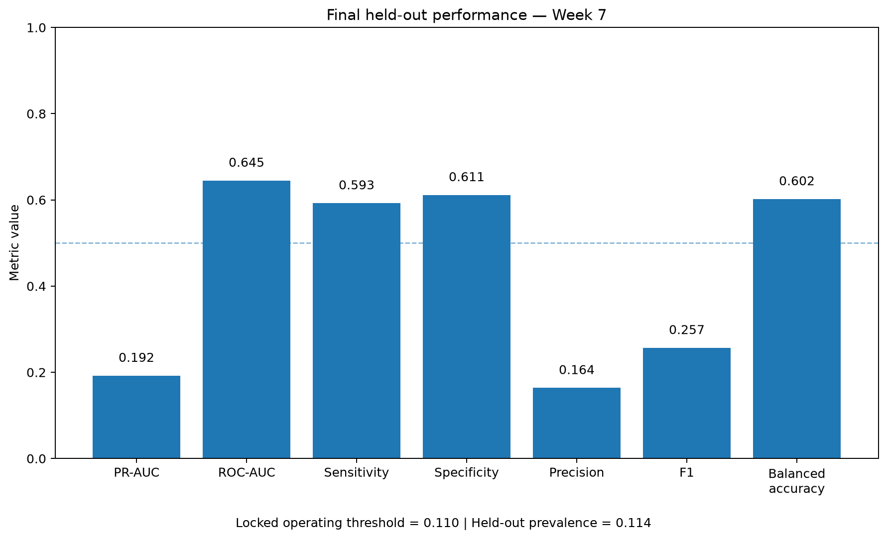
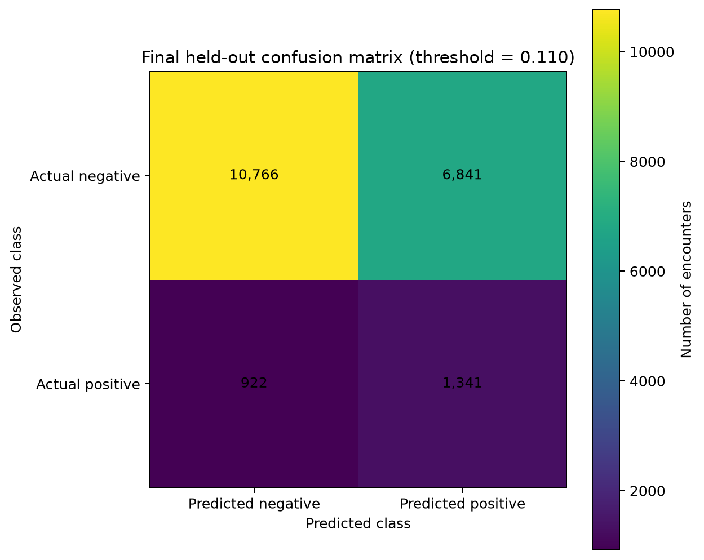
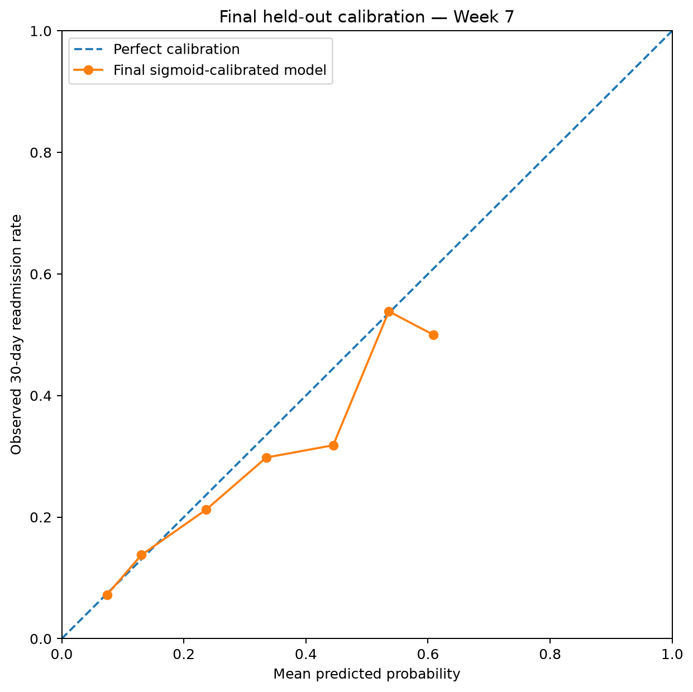

# Diabetes 30-Day Readmission — Reproducible Machine-Learning Pipeline

A reproducible machine-learning project for predicting **30-day hospital readmission among patients with diabetes**, with particular emphasis on patient-level leakage prevention, probability calibration, transparent model selection and protected final evaluation.

The project follows a staged development workflow in which model selection, calibration and operating-threshold decisions were completed using development data before a single final evaluation on an untouched held-out test set.

---

## Project status

**Development cycle completed.**

The final Week-7 held-out evaluation has been performed and the test set is now considered consumed for this development iteration.

The frozen final specification is:

| Component | Locked value |
|---|---|
| Model family | Random Forest |
| Trees | 300 |
| Maximum depth | 12 |
| Minimum samples per leaf | 5 |
| Class weighting | None |
| Random state | 42 |
| Model features | 42 |
| Probability calibration | Sigmoid |
| Operating threshold | 0.110 |
| Final evaluation | One-time protected held-out assessment |

No post-hoc model, calibration or threshold modification was performed after observing held-out performance.

---

## Clinical prediction problem

Hospital readmission is an important outcome in healthcare because it may reflect disease complexity, comorbidity burden, treatment requirements and care-transition challenges.

This project addresses the following predictive question:

> Using information available from a hospital encounter, can a reproducible machine-learning pipeline estimate the probability of readmission within 30 days for patients with diabetes?

The binary target used throughout the modelling pipeline is:

`readmitted_30d`

The objective is predictive rather than causal. The project does not attempt to determine whether any specific treatment or clinical factor causes readmission.

---

## Final held-out performance

The final protected evaluation used **19,870 encounters**, including **2,263 30-day readmissions**, corresponding to an event prevalence of approximately **11.39%**.

| Metric | Final held-out result |
|---|---:|
| ROC-AUC | **0.6450** |
| PR-AUC | **0.1924** |
| Brier score | **0.0980** |
| Log loss | **0.3410** |
| Balanced accuracy | **0.6020** |
| Sensitivity | **0.5926** |
| Specificity | **0.6115** |
| Precision | **0.1639** |
| F1 score | **0.2568** |
| Operating threshold | **0.110** |

The final mean predicted probability was approximately **0.1142**, close to the observed event prevalence.

The results indicate moderate discrimination. Because 30-day readmission is relatively uncommon, precision remains low despite sensitivity and specificity both being close to 0.60.

These results do not establish clinical utility.

---

## Final performance visualization

The figure above summarises the final frozen performance metrics obtained from the protected held-out cohort.

It is a reporting artefact generated after the Week-7 evaluation and does not perform model fitting, threshold optimisation, calibration fitting or any other modelling decision.

---

## Final confusion matrix

At the pre-specified operating threshold of **0.110**, the held-out confusion matrix was:

| | Predicted negative | Predicted positive |
|---|---:|---:|
| Actual negative | 10,766 | 6,841 |
| Actual positive | 922 | 1,341 |

Therefore:

- true negatives: **10,766**
- false positives: **6,841**
- false negatives: **922**
- true positives: **1,341**

This operating point yields:

- sensitivity: approximately **0.593**
- specificity: approximately **0.611**
- precision: approximately **0.164**
- F1 score: approximately **0.257**
- balanced accuracy: approximately **0.602**

The predicted-positive rate is approximately **41.2%**, substantially higher than the observed 30-day readmission prevalence.

This reflects the pre-specified balanced-accuracy threshold-selection objective and its associated sensitivity/specificity trade-off.

The threshold must not be interpreted as a clinically validated intervention threshold.

---

## Final probability calibration

The final Random Forest probabilities were calibrated using the **sigmoid calibration strategy selected and locked during Week 6**.

Held-out calibration results were:

| Calibration metric | Result |
|---|---:|
| Brier score | **0.0980** |
| Calibration intercept | **-0.0983** |
| Calibration slope | **0.9513** |
| ECE | **0.0065** |

A calibration slope close to 1 and the low expected calibration error indicate reasonably aligned predicted and observed probabilities on this held-out cohort.

These findings do not establish calibration transportability to another hospital, time period or patient population.

---

## Development workflow

The project follows a deliberately staged machine-learning development process.

### Week 1 — Data acquisition and cohort definition

The initial stage established:

- reproducible data acquisition;
- target definition;
- cohort construction;
- initial data-quality safeguards.

### Week 2 — Patient-safe partitioning

The dataset was partitioned at the **patient level** rather than only at the encounter level.

This prevents encounters belonging to the same patient from appearing in both development and held-out partitions.

The final held-out cohort contains:

- **19,870 encounters**
- **14,038 unique patients**

with:

- zero patient overlap;
- zero encounter overlap.

### Week 3 — Training-only exploratory analysis and cleaning

Exploratory analysis and deterministic cleaning were developed using training data only.

The held-out set remained outside the model-development process.

### Week 4 — Feature engineering and model schema

Clinical and administrative variables were transformed into a reproducible modelling schema.

The final model uses **42 features**.

The preprocessing and feature schema were frozen before final evaluation.

### Week 5 — Baseline modelling

Patient-safe out-of-fold development evaluation was used to establish baseline predictive performance.

The principal baseline model families were:

- Logistic Regression
- Random Forest

The Week-5 analyses remain in the repository as historical development evidence.

### Week 6 — Model selection

Formal model selection used **patient-grouped nested cross-validation**.

The primary selection metric was **PR-AUC**, reflecting the imbalanced binary outcome.

The final candidate model family was:

**Random Forest**

with:

- `n_estimators = 300`
- `max_depth = 12`
- `min_samples_leaf = 5`
- `class_weight = None`
- `random_state = 42`

The same Random Forest configuration was selected in all five outer folds.

The candidate model was selected exclusively from development data.

### Week 6 — Probability calibration

Probability calibration was evaluated separately from model-family selection.

Three strategies were compared:

- uncalibrated probabilities;
- sigmoid calibration;
- isotonic calibration.

Both calibrated alternatives satisfied the frozen eligibility rule.

Because isotonic calibration did not improve over sigmoid by more than one standard error of the paired fold-level Brier difference, **sigmoid calibration** was selected according to the pre-specified simplicity rule.

The calibration strategy was locked before threshold selection and before the held-out test set was accessed.

### Week 6 — Operating-threshold selection

Operating-threshold selection was performed using patient-safe, cross-fitted, calibrated development predictions.

Candidate thresholds ranged from **0.010 to 0.500** in increments of **0.005**.

The frozen selection hierarchy was:

1. highest mean balanced accuracy;
2. higher mean sensitivity if tied;
3. higher mean F1 if still tied;
4. lower threshold if still tied.

The selected operating threshold was:

**0.110**

Development out-of-fold performance at this operating point was approximately:

| Metric | Development OOF |
|---|---:|
| Balanced accuracy | 0.6030 |
| Sensitivity | 0.5918 |
| Specificity | 0.6142 |
| Precision | 0.1646 |
| F1 | 0.2575 |
| Predicted-positive rate | 0.4092 |

The threshold was then explicitly locked.

### Week 7 — Protected final evaluation

Before the held-out set could be evaluated, a pre-flight gate verified:

- candidate model locked;
- hyperparameters locked;
- sigmoid calibration locked;
- operating threshold locked at 0.110;
- zero patient overlap;
- zero encounter overlap;
- binary held-out target;
- training/held-out schema alignment;
- 42 model features;
- no previous held-out access record.

Only after all checks passed was the final evaluation executed.

The held-out test set was accessed once.

The resulting test performance was then recorded without any post-hoc model modification.

### Week 8 — Project finalization

After final evaluation, Week 8 is restricted to:

- documentation;
- visualization;
- reproducibility;
- QA;
- repository packaging.

No Week-8 change may be justified by improving the already observed held-out performance.

---

## Patient-level leakage prevention

Healthcare datasets frequently contain multiple encounters belonging to the same individual.

Randomly splitting rows without accounting for patient identity can therefore allow information from the same patient to appear in both training and validation data.

This project explicitly prevents that leakage.

Patient identifiers are used to define development and held-out partitions and to construct grouped cross-validation folds.

The final Week-7 pre-flight audit confirmed:

- development encounters: **79,473**
- held-out encounters: **19,870**
- development unique patients: **55,952**
- held-out unique patients: **14,038**
- patient overlap: **0**
- encounter overlap: **0**

Patient-level leakage prevention is treated as a methodological requirement rather than an optional modelling enhancement.

---

## Nested cross-validation

Model selection was conducted with nested cross-validation.

The outer loop estimates candidate performance on unseen development folds.

The inner loop performs model configuration selection.

This separation reduces optimistic bias associated with evaluating candidate configurations on the same observations used to select them.

Week-6 nested evaluation used:

- **5 outer folds**
- **3 inner folds**
- patient grouping
- PR-AUC as the primary model-selection criterion.

The selected Random Forest showed stable hyperparameter selection across all five outer folds.

---

## Why PR-AUC?

The outcome is imbalanced, with approximately **11%** of encounters experiencing 30-day readmission.

ROC-AUC remains useful for evaluating ranking discrimination, but it can appear relatively favourable when the negative class dominates.

PR-AUC provides additional focus on performance for the positive class and was therefore used as the primary model-selection metric.

Model selection did not rely on any single metric in isolation.

Probability quality, stability, interpretability and methodological simplicity were also considered.

---

## Calibration and discrimination are separate

A model can rank individuals reasonably well while producing poorly calibrated absolute probabilities.

For that reason, this project treats:

- discrimination;
- probability calibration;
- operating-threshold selection

as separate methodological stages.

Model-family selection occurred first.

Probability calibration was then assessed using cross-fitted development predictions.

Only after calibration was frozen was the operating threshold selected.

This prevents the final held-out test set from influencing any of these decisions.

---

## Development versus held-out performance

The final test results are broadly compatible with the development estimates.

The selected Random Forest had nested-development performance around:

- PR-AUC: approximately **0.207**
- ROC-AUC: approximately **0.647**
- Brier score: approximately **0.098**

The final held-out performance was:

- PR-AUC: approximately **0.192**
- ROC-AUC: approximately **0.645**
- Brier score: approximately **0.098**

ROC-AUC and Brier score remained highly consistent between development and the final held-out evaluation.

The lower final PR-AUC is compatible with ordinary sampling and cohort variation and was not used to alter the model after evaluation.

---

## Automated testing and QA

The repository includes automated tests covering core stages of the pipeline.

Current project QA status:

**61 tests passed**

The test suite includes safeguards for:

- data processing;
- feature engineering;
- model preprocessing;
- baseline modelling;
- model comparison;
- nested model selection;
- selection locking;
- probability calibration;
- threshold selection;
- protected final evaluation;
- Week-8 visualization artefacts.

Source-control QA also includes:

`git diff --check`

to detect whitespace errors before versioning.

The final visualization artefacts are additionally tested for existence and non-zero file size.

---

## Reproducible final visualizations

Week 8 generates the portfolio-facing final figures directly from the frozen Week-7 result artefacts.

The visualization command is:

`python -m diabetes_readmission.w8_visualization`

It produces:

- `figures/w7_final_performance_summary.png`
- `figures/w7_final_confusion_matrix.png`
- `figures/w7_final_calibration.png`

The visualization stage performs **no model fitting, calibration fitting, threshold optimisation or held-out decision making**.

---

## Repository structure

    diabetes-readmission-ml-pipeline/
    ├── data/
    │   ├── raw/
    │   ├── processed/
    │   └── intermediate/
    ├── figures/
    │   ├── eda_target_distribution.png
    │   ├── eda_age_readmission_prevalence.png
    │   ├── eda_prior_inpatient_readmission_prevalence.png
    │   ├── baseline_logistic_calibration.png
    │   ├── baseline_logistic_probability_distribution.png
    │   ├── w7_final_performance_summary.png
    │   ├── w7_final_confusion_matrix.png
    │   └── w7_final_calibration.png
    ├── reports/
    │   ├── model_selection_protocol.md
    │   ├── w5_model_comparison_findings.md
    │   ├── w6_model_selection_decision.md
    │   ├── w6_calibration_protocol.md
    │   ├── w6_calibration_decision.md
    │   ├── w6_threshold_protocol.md
    │   ├── w6_threshold_decision.md
    │   ├── w7_final_evaluation_protocol.md
    │   ├── w7_final_evaluation_findings.md
    │   ├── w7_final_metrics.csv
    │   ├── w7_final_confusion_matrix.csv
    │   ├── w7_final_calibration.csv
    │   └── w8_project_finalization_protocol.md
    ├── src/
    │   └── diabetes_readmission/
    │       ├── model_preprocessing.py
    │       ├── modelling.py
    │       ├── model_selection.py
    │       ├── selection_lock.py
    │       ├── calibration.py
    │       ├── threshold_selection.py
    │       ├── w7_preflight.py
    │       ├── w7_final_evaluation.py
    │       └── w8_visualization.py
    ├── tests/
    ├── model_card.md
    ├── requirements.txt
    ├── requirements-lock.txt
    └── README.md

Large intermediate and row-level prediction artefacts remain local when appropriate and are not committed merely for convenience.

---

## Main reproducibility commands

From the repository root, activate the project environment.

For example:

`conda activate ./.venv`

Run the automated test suite:

`python -m pytest -q`

Run source formatting/whitespace QA:

`git diff --check`

Generate the final Week-8 visualizations:

`python -m diabetes_readmission.w8_visualization`

The one-time Week-7 held-out evaluation is **not** a routine reproducibility command because the held-out test set has already been consumed for this development iteration.

---

## Key project artefacts

### Model selection

- `reports/model_selection_protocol.md`
- `reports/w6_model_selection_decision.md`
- `reports/w6_selected_model.json`

### Calibration

- `reports/w6_calibration_protocol.md`
- `reports/w6_calibration_findings.md`
- `reports/w6_calibration_decision.md`
- `reports/w6_calibration_lock.json`

### Threshold selection

- `reports/w6_threshold_protocol.md`
- `reports/w6_threshold_findings.md`
- `reports/w6_threshold_decision.md`
- `reports/w6_threshold_lock.json`

### Final evaluation

- `reports/w7_final_evaluation_protocol.md`
- `reports/w7_preflight_audit.csv`
- `reports/w7_final_metrics.csv`
- `reports/w7_final_confusion_matrix.csv`
- `reports/w7_final_calibration.csv`
- `reports/w7_final_evaluation_findings.md`
- `reports/w7_final_evaluation_run_state.json`

### Final model documentation

- `model_card.md`

---

## Model interpretation

The final model demonstrates measurable predictive signal for 30-day readmission, but its discrimination remains moderate.

A ROC-AUC of approximately **0.645** indicates that the model ranks higher-risk and lower-risk encounters better than chance, but substantial overlap remains between patients who are and are not readmitted.

The PR-AUC of approximately **0.192** should be interpreted relative to the event prevalence of approximately **0.114**.

Probability calibration on the held-out cohort was comparatively strong, with:

- Brier score approximately **0.098**
- calibration slope approximately **0.95**
- ECE approximately **0.0065**

At the frozen operating threshold of **0.110**, sensitivity and specificity are both close to 0.60.

However, the positive predictive value remains low because of the imbalanced outcome.

---

## Limitations

Important limitations include:

- retrospective observational data;
- class imbalance;
- limited clinical granularity;
- heterogeneous hospital populations;
- potential temporal and institutional distribution shift;
- absence of external validation;
- absence of prospective validation;
- no clinical-utility analysis;
- no decision-curve analysis;
- no causal interpretation.

The final held-out result represents internal validation for the current development iteration, not external clinical validation.

---

## Future work

Any future performance-improvement work must begin as a **new development iteration**.

Potential future directions include:

- independent external validation;
- temporal validation;
- richer longitudinal patient histories;
- additional laboratory and clinical variables;
- gradient-boosted tree models;
- explicit missingness modelling;
- subgroup and fairness analysis;
- uncertainty quantification;
- decision-curve analysis;
- clinical-utility assessment.

The current held-out cohort must not be reused as a tuning set.

---

## Skills demonstrated

This project demonstrates practical experience with:

- Python;
- pandas and NumPy;
- scikit-learn;
- clinical machine learning;
- imbalanced classification;
- patient-level data partitioning;
- leakage prevention;
- nested cross-validation;
- probability calibration;
- operating-threshold analysis;
- model evaluation;
- automated testing with pytest;
- Git and GitHub workflows;
- reproducible scientific documentation.

The emphasis is not simply on obtaining the highest possible metric.

The primary objective is to build a **traceable, reproducible and methodologically defensible predictive workflow**.

---

## Development closure

The Week-7 protected evaluation completed the current predictive-development cycle.

The following components are now frozen:

1. Random Forest model family;
2. selected hyperparameters;
3. preprocessing and 42-feature schema;
4. sigmoid calibration;
5. operating threshold of 0.110;
6. final held-out evaluation.

Week 8 is restricted to documentation, visualization, QA, reproducibility and project packaging.

No Week-8 modification may be justified by improving the already observed held-out performance.

---

## Disclaimer

This repository is a data-science and machine-learning portfolio project.

The model is **not a clinically validated medical device or clinical decision-support system** and must not be used to make patient-care decisions without appropriate independent validation, clinical evaluation and regulatory assessment.
